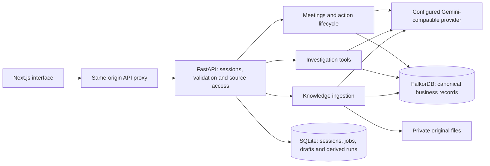

# Brian

Brian (company brain) keeps meetings, work handovers and action items connected to the evidence behind them. Capture a discussion, review an AI recap, assign the work, carry unfinished items into the next session and record the outcome when each item closes.

The included **DigiPlus Services** workspace is a fictional IT consulting and managed-services company. It is independent of the real DigiPlus organization. The dataset contains **40 people, 8 teams, 10 client projects, 200 knowledge records, 40 meetings/handovers and 100 distinct action items**. It replaces the former retail workspace.

## Quick start

Requirements: Docker Desktop (or Docker Engine with Compose v2), Python 3 for configuration, and optionally `make`. Host Node.js and Python application dependencies are not required for Docker.

```sh
python3 scripts/init_env.py
```

This creates a private, ignored `.env` with random session/operator secrets. It preserves an existing file. Configure Gemini in that file:

```dotenv
LLM_PROVIDER=openai-compatible
LLM_BASE_URL=https://generativelanguage.googleapis.com/v1beta/openai
LLM_MODEL=gemini-3.1-flash-lite
LLM_API_KEY=your-gemini-api-key
FALKORDB_GRAPH=company_brain_digiplus_services
```

Keep the other generated settings. Never put the key in browser code or a `NEXT_PUBLIC_` variable. Start Docker, then:

```sh
make up
# Equivalent: docker compose up --build -d
```

Open **[Meetings & handovers](http://localhost:3000/)**. Other views are [Action items](http://localhost:3000/actions), [Investigate](http://localhost:3000/investigate), [Sources](http://localhost:3000/sources) and [Workspace guide](http://localhost:3000/guide).

Startup inserts missing knowledge and workflow records without overwriting edits. The first build needs internet access. Gemini calls also need network access and an enabled key/model. Without AI, notes and manual recaps/action management still work; catch-up generation explicitly falls back to saved context.

## Walk through the product

1. Choose **Lead** in the workspace role control to see the complete dataset. Engineer has delivery-team access; Viewer sees employee-wide records and cannot change business data. These are local role previews, not production sign-in.
2. Filter meetings to **Atlas Client Portal**. Open **Leave coverage handover** to see the client context, recorded decision, absent colleague, action evidence and carry-forward history. The linked company knowledge includes a deliberately unresolved Identity Gateway ownership conflict.
3. Open **Delivery checkpoint** and choose **Generate AI recap**. Review the summary, decisions, owners, dates, exact quotations and suggested knowledge links. Edit/remove proposals, then confirm. Existing actions with the same quotation/owner are not duplicated.
4. Choose a colleague and **Prepare catch-up brief**. Each paragraph exposes its supporting context. This is a preview; the application sends no email or chat message.
5. Choose **Create follow-up / handover**. Select unfinished actions to carry forward. The same action IDs, original due dates and full histories stay attached to both sessions; follow-up access is preserved.
6. Open an action's **Update** form. Reassign it, change its due date or status, then close it with a required outcome or cancellation reason. In **Action items**, filter by owner, overdue status or carried-forward work.
7. Create a new session with agenda, invited people, attendance and pasted notes. A planned session can receive notes later through **Update notes**. Confirmed notes remain immutable; new context belongs in a follow-up.

For a fresh AI example, create an engineering session for Atlas Client Portal, invite Maya Rao, Dev Shah and Leah Chen, mark Dev absent, and paste:

```text
Northstar handover: Dev Shah missed the discussion.
Decision: require recorded client approval before the portal rollout.
Maya Rao will validate the tenant mapping by 2026-11-02.
Leah Chen will obtain client acceptance sign-off by 2026-11-03.
The Identity Gateway ownership conflict remains unresolved.
```

## Dataset and assumptions

| Data | Size |
| --- | ---: |
| People / teams / clients | 40 / 8 / 10 |
| Projects / shared systems | 10 / 16 |
| Tickets / recorded decisions / commitments | 60 / 24 / 12 |
| Knowledge source records / exact-span assertions | 200 / 432 |
| Meetings and handovers / distinct action items | 40 / 100 |

The knowledge sources comprise 94 documents, 21 chat exports, 60 tickets, 24 decisions and a shared directory. Workflows form ten four-session chains: kickoff, leave coverage, delivery checkpoint and support transition. An action can appear in several sessions while remaining one record. Historical closed items have outcomes; open/blocked items have follow-up history.

The projects cover a logistics portal, healthcare reporting, banking delivery approvals, insurance claims, telecom monitoring, consultant scheduling, client success, partner integration, restricted support transition and cloud migration. Cases include shared systems, conflicting ownership records, missing client approval, an absent approver, consultant allocation conflicts, escalation gaps and rollback readiness. The final cloud project is employee-visible; one project chain is leadership-only.

All people, clients and records are invented. Seed recaps are reviewed input records, not canned responses from the live model. New recaps and briefs call the configured provider. Names of people/projects must currently exist in the shared directory; arbitrary company onboarding/entity creation is not implemented.

The older graph-investigation scenario uses the fixed `DEMO_CLOCK_ISO=2026-10-17T04:30:00Z` for reproducible source freshness and dependency examples. Meeting schedules are explicit timestamps; the action board calculates overdue dates against today's UTC date. A completed meeting can still have unfinished actions, which carry into its follow-up.

`fixtures/digiplus/registry.json` contains public entity names/aliases. `manifest.json` lists source checksums and the workflow checksum. Each source JSON has readable content plus exact-span assertions; `workflows.json` holds meetings, actions, note quotations and event histories.

```sh
python3 scripts/build_fixtures.py
```

This regenerates the dataset and workspace catalog, and the source book when optional `docs/` exists. It does **not** reset a running graph. Startup preserves existing revisions and action edits. Keep `fixtures/digiplus/`: the application reads the directory at runtime as well as using the initial data. `evals/questions.jsonl` contains separate regression inputs, never company facts.

The former BrightMart graph and private operational files were preserved. Its fixture files were moved to ignored `.data/retired-fixtures/brightmart/`; the active graph and container SQLite path are separate. Do not point the new seed at the old graph, which would mix the companies.

## Everyday commands

| Task | Command |
| --- | --- |
| Build and start the complete stack | `make up` |
| Start cached images without rebuilding | `make up BUILD_FLAG=--no-build` |
| Stop while retaining data | `make down` |
| Resume containers | `docker compose up -d` |
| Check services | `docker compose ps` |
| View service output | `docker compose logs -f api web` |
| Apply API configuration changes | `docker compose up -d --force-recreate api` |
| Read structured application events | `docker compose exec api tail -n 20 /data/logs/application.jsonl` |

The graph uses `graph-data`; SQLite, private originals and application logs use `api-data`. Both survive ordinary restarts and `docker compose down`. **`docker compose down -v` deletes these volumes.**

Only the web port is exposed on `127.0.0.1:3000`. API and FalkorDB remain private to the Compose network. For another local port:

```sh
WEB_PORT=3001 ALLOWED_ORIGIN=http://localhost:3001 docker compose up --build -d
```

Use the same overrides on later recreation. On PowerShell, set `$env:WEB_PORT` and `$env:ALLOWED_ORIGIN` first. Never publish `.env`, database dumps or resolved `docker compose config` output.

## Architecture



Next.js/TypeScript provides the interface and React Flow evidence graph. FastAPI/Pydantic validates typed contracts. FalkorDB owns company entities, claims, source revisions, reviews, meetings and actions. SQLite holds operational records, unconfirmed AI drafts and derived investigation output; it is not an alternate company facts database.

Run **one API process/worker per graph**. Mutations and access-sensitive snapshots share the repository's process lock. Model calls happen outside that lock. Shared coordination would be required before adding workers.

### Meeting and action persistence

`WorkRecord` nodes store typed canonical meeting/action payloads. Every write creates an immutable `WorkRevision` snapshot and increments the graph epoch in the same graph mutation. Stable IDs link actions to their original meeting and subsequent sessions. Writes check `expected_version` under the shared lock; stale edits return 409.

Meetings store agenda, participants, absent people, schedule, project, ACL, notes, decisions, recap, linked knowledge, action IDs and lifecycle. Actions store owner, due date, status, original quotation, original/current meeting IDs, outcome and event history. Closure requires an outcome; follow-ups cannot carry closed items or broaden their previous session's access groups. Notes updates preserve passages supporting existing actions and are unavailable after recap confirmation.

### Meaningful AI use

**Recap:** permitted meeting notes + directory + up to 12 relevant knowledge passages → structured model output → schema, exact-quote, owner/date and source-ID validation → private draft → human review → canonical decisions/actions. Missing owners/dates remain unset. The model receives no executable graph query or write capability. Drafts expire after 30 minutes and are invalidated when their meeting version or captured graph epoch changes.

**Catch-up:** permitted notes, recap, current actions, outcomes, carry-forward/reassignment events and linked evidence → short AI paragraphs with validated reference IDs. Access and epoch are rechecked before returning. On provider failure, the response explicitly labels saved context rather than claiming AI generation. A brief is never sent automatically.

**Knowledge investigations:** the model plans an intent and selects reviewed reads: `resolve_entity`, `search_evidence`, `get_project_context`, `trace_dependencies`, `find_blockers`, `find_ownership`. Graph reasoning builds evidence-backed findings; model synthesis is derived. Limits remain six tool reads, two selection rounds, three `DEPENDS_ON` hops, a 2,000-claim snapshot, 150 claims per tool, 16 model-observation passages, 32 answer excerpts and a 30-node/50-edge displayed graph. Default query/run/provider timeouts are 1.5/25/10 seconds. Scope limits and deterministic fallbacks remain visible.

A valid quote/reference establishes traceability, not universal semantic correctness. Human review remains important. Unknown names remain unresolved rather than silently joining the public directory. Recap model instructions live in `app/work/service.py`; investigation/extraction prompts live in `app/prompts/`; `app/agent/provider.py` owns provider transport and one schema-repair attempt.

### Knowledge evidence and access

Entity kinds are Person, Team, Project, Service, Customer, Ticket, Decision and Commitment. Source → SourceRevision → Chunk stores provenance. Claim → SUBJECT/OBJECT links an assertion to its entities; SUPPORTED_BY carries its exact quotation span. Predicates include USES, DEPENDS_ON, BLOCKS, STATUS, REQUIRES, MADE_TO, DUE_ON, OWNED_BY, MEMBER_OF, WORKED_ON and ABOUT. UI relationship edges retain their claim/evidence IDs.

Assertions remain independent per source. Quotes use Unicode code-point offsets with an exclusive end. Ingestion validates spans, predicate/entity types and active revision eligibility. Low extraction scores below 0.85 remain pending; this is a heuristic, not a calibrated truth probability. Source revisions stage before atomic activation; failed imports leave the current revision usable. Old revisions remain historical. Conflicts are preserved rather than resolved by recency, and contribution does not establish ownership.

Source access is checked before model input and on saved answers, citations, reviews and meeting knowledge links. Empty ACLs deny access. Role sessions use signed HttpOnly cookies; mutations check capability and same-origin/CSRF requirements. Private histories remain user-scoped. Recaps with inaccessible or changed linked evidence are withheld for review rather than replaying restricted passages.

Knowledge imports accept UTF-8 Markdown/text or strict JSON: at most 20 files/job, 2 MB/file and 100,000 normalized characters/source. PDF/OCR, live email/chat/calendar/audio connections and external URLs are not implemented; paste meeting transcripts or notes instead. Public imports cannot submit accepted fixture claims.

### API contracts

Routes are under `/api/v1`. Pydantic models generate `apps/web/lib/api/openapi.json` and `schema.ts`; run `make contract` after changes. Host-development reference: `http://127.0.0.1:8000/docs`.

| Routes | Purpose |
| --- | --- |
| `GET/POST /meetings`, `GET/PATCH /meetings/{id}` | Create, list, inspect and change session lifecycle |
| `PATCH /meetings/{id}/notes` | Revision-checked notes update |
| `POST /meetings/{id}/recap`, `POST /meetings/{id}/confirm-recap` | Generate a draft, then confirm reviewed records |
| `POST /meetings/{id}/actions` | Add an action supported by the notes |
| `GET /actions`, `PATCH /actions/{id}` | List, assign, reschedule, progress and close actions |
| `POST /meetings/{id}/brief` | Preview a referenced catch-up brief |
| `/investigations`, `/history`, `/sessions`, `/entities/search` | Existing knowledge investigation and private history |
| `/sources`, `/imports`, `/jobs/{id}`, `/evidence/{id}` | Source management, asynchronous imports and evidence |
| `/reviews/proposals`, `/reviews/confirm`, `/reviews` | Preview/confirm/list internal evidence reviews |
| `/health/live`, `/health/ready`, `/me`, `/demo/session` | Health and local role sessions |

## Logging

Application events are JSON Lines in `LOG_PATH`: `.data/logs/application.jsonl` on the host, `/data/logs/application.jsonl` in Docker. The file rotates at 5 MB with three backups. Each event has a timestamp, log level and request/correlation ID. Every API response includes `X-Request-ID`; typed error responses use the same ID.

Events cover requests, record creation, notes/lifecycle updates, action reassignment/carry-forward/closure, recap confirmation, AI latency/outcome/schema failures, graph-query timings and contextual error types. Logs omit API keys, cookies, original notes and provider error bodies. Record histories contain business change details in the authorized graph, separate from application logs. Container stdout is available through Compose in addition to the structured file.

## Special feature: evidence-backed continuity

Every extracted action and decision retains its exact note passage. Carry-forward links preserve the same action rather than copying it; reassignment and closure retain their history and outcomes. Catch-up briefs expose references and show what changed across sessions, while the company graph provides broader dependency and ownership context. This helps an incoming colleague understand both **what to do** and **why the work exists**.

## Development and checks

Host development needs Python 3.12+, `uv`, Node.js 22+, npm and a Unix-like shell (WSL on Windows). Stop container API/web processes before starting their host equivalents.

```sh
docker compose stop api web
make setup
make dev
make seed
# In separate terminals:
make api
make web
```

`make dev` exposes FalkorDB only on `127.0.0.1:6389`. On Linux/WSL use `make setup UV_CACHE_DIR=/tmp/company-brain-uv`. Old exported `FALKORDB_*`/storage environment values override `.env`; remove them if host development selects an unexpected workspace.

```sh
make check        # Ruff, OpenAPI synchronization, strict TypeScript
make build        # Production frontend build
make test-unit
make test-graph   # Random, isolated graphs; never resets the working graph
make evaluate     # 24 deterministic knowledge cases, isolated warm sample
make test-e2e     # Desktop/mobile browser checks; Google Chrome required
BRAIN_API_URL=http://127.0.0.1:3000 make smoke
```

To run graph checks while the container stack is running, expose the local test port and wait for readiness:

```sh
docker compose -f compose.yaml -f compose.dev.yaml up -d --wait falkordb
```

Ordinary tests disable paid model calls. The explicit live checks use your configured key and random disposable graphs:

```sh
PYTHONPATH=services/api .venv/bin/python scripts/verify_work_live.py
PYTHONPATH=services/api .venv/bin/python scripts/verify_live_model.py
```

The workflow check exercises unseen notes, real recap extraction, confirmation, carry-forward identity, reassignment, closure, real catch-up generation and Viewer isolation. Generated reports belong in ignored `artifacts/`. Browser checks can create reviews and mutate/restore the included ticket data; use the fictional workspace only.

## Deployment and limitations

The Docker package is the deployment unit. A suitable server must run the web/API/FalkorDB stack with persistent volumes, private database networking, backend secrets, TLS and an origin matching `ALLOWED_ORIGIN`. Put a reverse proxy in front of the loopback web port, back up both volumes and verify restore. This repository does not contain cloud account credentials or an observed public deployment.

Local workspace role selection is for evaluation with fictional data. Production SSO/authentication, multi-tenant isolation and real company onboarding remain separate work. Background email reminders, recipient delivery/acknowledgement and live SaaS/audio connectors are not claimed. Follow-up is implemented through the persistent action board, overdue filters and subsequent agendas. Broad human semantic-support scoring and large-scale performance testing are unperformed.

Keep fixture/generator code, regression inputs, `.env.example`, Compose/Dockerfiles, lockfiles and API contracts in Git. Do not commit `.env`, `.data`, private originals, databases, logs, dependency/build folders or generated traces/reports. `docs/` and the original `Architecture.md` are optional historical material; this README is the maintained implementation guide. `graphify-out/` is a supplied source-code map and is not runtime company data.

## Verification record

Observed locally on **30 October 2026**:

| Check | Result |
| --- | --- |
| Complete backend suite | **51 passed**, using isolated random FalkorDB graphs |
| Knowledge regression | **24/24 passed** on the DigiPlus corpus |
| Static checks | Ruff, OpenAPI/type synchronization and strict TypeScript passed |
| Container build/start | Normal Dockerfiles built successfully; web/API/FalkorDB started through the local package |
| Running-stack smoke | Passed with a live-model ownership-conflict answer and 13 evidence excerpts |
| Opt-in live Gemini workflow | Passed with `gemini-3.1-flash-lite`: 2 extracted actions, 1 decision, knowledge links, carry-forward, reassignment, closure, a referenced brief and Viewer isolation; 5.41 seconds for that isolated run |
| Browser walkthrough | Created a handover, added notes, reviewed/confirmed a live recap, carried actions forward, reassigned/closed one with an outcome, generated a live brief and reopened saved data after container replacement |
| Responsive/access checks | Inspected at 1280 px and 390 px; no horizontal page overflow in the checked views. Owner/status/search filters and Viewer restrictions verified |
| Fixture integrity | All source/workflow checksums, exact note quotations and carry-forward references validated |

The browser walkthrough left two useful Northstar sessions and their two action records in this local workspace, in addition to the 40-session/100-action reproducible seed. It did not reset the dataset. Screenshots and the live report are in ignored `artifacts/`.

One upstream Starlette/httpx TestClient deprecation warning remains. An intermediate check overlapped container/database recreation and failed to connect; the completed run above used the ready database. Previous BrightMart timing and persistence measurements describe the former corpus. No public deployment, broad human semantic-quality score or full accessibility certification is inferred from these checks. Server deployment is intentionally deferred; this delivery remains local.
